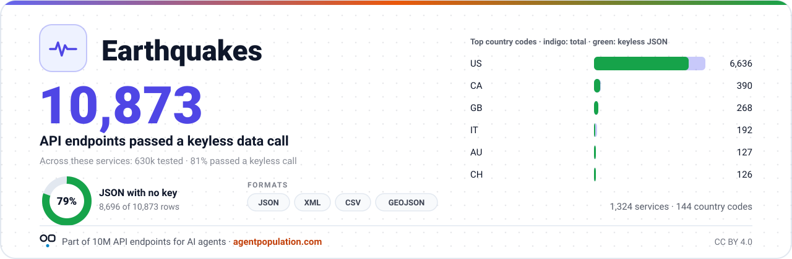
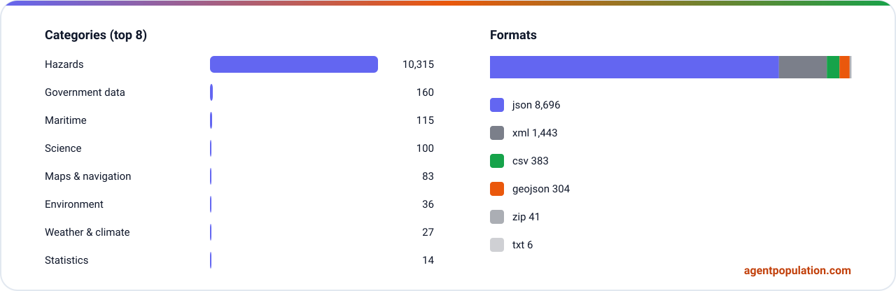

<p align="center"></p>

# 🌍 Earthquake API endpoints

**10,873 earthquake API endpoints that answered a keyless GET with a data body. For agent and app builders.**

<p align="center"><a href="#files"></a> <a href="#columns-and-tags"></a> <a href="#whats-inside"></a> <a href="#whats-inside"></a> <a href="LICENSE"></a></p>

<p align="center"><a href="#whats-in-it-for-you">What's in it</a> · <a href="#for-ai-agents">For AI agents</a> · <a href="#quick-start">Quick start</a> · <a href="#test-it-yourself">Test it yourself</a> · <a href="#files">Files</a> · <a href="#licence-and-credit">Licence</a> · <a href="#part-of-10m-api-endpoints-for-ai-agents">More packs</a></p>

This repository holds a 1,000-row sample and the services list; the full list of 10,873 endpoints is one download from the [latest release](https://github.com/agentpopulation/10k-earthquake-apis-for-agents/releases/latest).

**Endpoints for building an earthquake lookup or map tool.** Fault, liquefaction, microzonation and seismic-hazard map layers, most of them on ArcGIS Online, plus USGS and EMSC earthquake event queries by country box, as URLs that answered with no key on their test date. The event queries are the smaller part; the App features bucket counts them.

Selection rule: rows where `tags has earthquakes`, less the rows that a leave-out rule drops (each counted under Known limits).

6,177 of these 10,873 rows match the focus rule (below); the others are in the pack by the selection rule only, and Known limits says what they are. 6,481 rows (59.6%) are map layers on ArcGIS Online, where anyone can publish.

## In plain words

**What is an API endpoint?** An API endpoint is one web address that a program can ask for data, for example the latest reading at one weather station. A single service, such as a national weather agency, can have thousands of endpoints: one per station, city or dataset. This pack counts endpoints, not separate services.

**What does "passed a data call" mean?** On the date shown in each row, AgentPopulation sent one plain request to that address, with no password or key, and got a non-empty data body back (JSON, CSV, XML or a file): not an error page and not an empty result. Some bodies describe a dataset rather than hold its values; see Known limits. It shows the address answered with data on that day. It is not a promise that it answers today, and licences and usage limits were not reviewed.

## What's in it for you

Four ways to use this pack. Each bucket gives a count, a filter you can apply to the CSV, one example that passed, and a list of recommended starting points with the rule that picked them. Buckets overlap; a row can fit more than one.

Examples, recommended lists and the preview are drawn from rows that match this pack's focus rule, so a row that the selection rule put in this pack but that is about something else is not shown as a starting point. Counts cover the whole bucket.

<details>
<summary>The focus rule</summary>

Focus rule: `title matches /earthquake|quake|seism|sism|\bfaults?\b|liquefact|epicent|shakemap|shake intensity|magnitude|tectonic|microzon|σεισμ|erdbeben|terremot|aardbeving|deprem|richter/i AND NOT title or subcategory matches /seismic[- ](lines?|profiles?|horizons?|shots?|stratigraph|sparker|reflection)|seismic[- ]survey[- ]profiles|seismic surveys?\b|refractive seismic|seismic refraction|sismica[ _]rifrazione|marine[- ]seismic|time-lapse[- ]seismic|seismics|seismik|seismiek|seismische|reflexionsseism|sub-bottom|[23]d[ -]seism/i AND NOT title matches /reconstruct|payment|contribution|funding|recovery plus/i AND NOT title matches /\btest\b|_test|test_|\bdemo\b|_demo|gis_iii|^seismic monitoring stations /i AND NOT url matches /request=getcapabilities/i`

</details>

### 🤖 Agent tools: Fault, seismic-hazard and earthquake layers an agent can query

**5,567** endpoints from 882 services · Wrap one layer query as a get_quake_layer tool: return the features (magnitude, fault name or hazard class) with a timeout. The tested layer queries return a few attribute rows and no geometry; set `returnGeometry=true` and add `geometry=lon,lat&geometryType=esriGeometryPoint&inSR=4326&spatialRel=esriSpatialRelIntersects` to ask about one place.

4,254 of these are map-layer queries that asked for a few records (`resultRecordCount`); raise it or page through for the whole layer.

Start with: `tags has agent-ready AND title matches /earthquake|quake|seism|sism|\bfaults?\b|liquefact|epicent|shakemap|shake intensity|magnitude|tectonic|microzon|σεισμ|erdbeben|terremot|aardbeving|deprem|richter/i`

Example: [M2.5 Recent Earthquakes](https://earthquake.usgs.gov/arcgis/rest/services/eq/Recent_Earthquakes/MapServer/0/query?where=1%3D1&outFields=*&returnGeometry=false&resultRecordCount=5&f=json) · USGS Earthquake Hazards · passed 2026-11-14

<details>
<summary>Recommended starting points: 8 services, picked by the stated criteria inside</summary>

**Recommended starting points.** Selected by stated criteria, not a ranking of quality: Services in this pack with the most endpoints that match this bucket and are tagged `agent-ready` (no key sent in the test call, JSON body, passed a data call). Ties go to the service with more country codes, then by name. Only services with at least one bucket row that matches the focus rule are listed, and the sample comes from those rows; the counts cover the whole bucket. The sample URL is the first row by URL sort after preferring, in this order: rows that match the bucket's sample preference when it has one, rows that return values rather than describe a dataset or a service (not ERDDAP /info/ pages, OGC GetCapabilities requests, bare OWS addresses, PxWeb tables, UN SDG series lists, Statistics Canada download pointers, WorldPop listings, GTFS validation reports, untitled rows or service root addresses), and agent-ready rows. Sample preference in this bucket: `NOT url matches ///(services[0-9]*(-[a-z0-9]+)?|utility)\.arcgis\.com//i AND title matches /earthquake|fault|liquefaction/i`. Services named "ArcGIS organization" hold map layers from many owners and are added only when fewer than 5 other services match.

| Service (host) | Endpoints in bucket | In pack | Country codes in bucket | Formats in bucket | Sample URL that passed |
|---|---:|---:|---|---|---|
| USGS Earthquake Hazards (earthquake.usgs.gov) | 1,021 | 1,144 | 13 codes | json | [M2.5 Recent Earthquakes](https://earthquake.usgs.gov/arcgis/rest/services/eq/Recent_Earthquakes/MapServer/0/query?where=1%3D1&outFields=*&returnGeometry=false&resultRecordCount=5&f=json) (2026-11-14) |
| Doi (doi.org) | 170 | 209 | global or unknown | json | [2017 Valparaiso, Chile earthquake data …](https://doi.org/10.5066/F71Z439C) (2026-11-15) |
| ArcGIS Online for Ontario Schools (ArcGIS Online) (services.arcgis.com) | 157 | 194 | CA, GB, US | json | [.Buffer of Tokyo Earthquake (Points)](https://services.arcgis.com/QI0dObYawrKkuwDp/arcgis/rest/services/.Buffer%20of%20Tokyo%20Earthquake%20%28Points%29/FeatureServer/0/query?where=1%3D1&outFields=*&returnGeometry=false&resultRecordCount=5&f=json) (2026-11-15) |
| Temple University (ArcGIS Online) (services.arcgis.com) | 96 | 96 | ES, GB, US | json | [“USGS Earthquake Magnitude (Past 30 Day…](https://services.arcgis.com/6fiE7QkLWSPMd0N5/arcgis/rest/services/%E2%80%9CUSGS_Earthquake_Magnitude_%28Past_30_Days%29%E2%80%9D/FeatureServer/0/query?where=1%3D1&outFields=*&returnGeometry=false&resultRecordCount=5&f=json) (2026-11-14) |
| University of Minnesota (ArcGIS Online) (services.arcgis.com) | 69 | 81 | CN, US | json | [3\_Earthquakes txt spreadsheet (clean) \_…](https://services.arcgis.com/8df8p0NlLFEShl0r/arcgis/rest/services/3_Earthquakes_txt_spreadsheet_%28clean%29___Copy_of_Earthquakes/FeatureServer/0/query?where=1%3D1&outFields=*&returnGeometry=false&resultRecordCount=5&f=json) (2026-11-14) |
| Toronto District School Board (ArcGIS Online) (services2.arcgis.com) | 68 | 147 | CA, GB, US | json | [“Recent Earthquakes”](https://services2.arcgis.com/PuP9I73SXDqGc9Kp/arcgis/rest/services/%E2%80%9CRecent_Earthquakes%E2%80%9D/FeatureServer/0/query?where=1%3D1&outFields=*&returnGeometry=false&resultRecordCount=5&f=json) (2026-11-14) |
| Gymnasium Neufeld (ArcGIS Online) (services4.arcgis.com) | 65 | 91 | CH, DE | json | [Aarons\_Erdbebenrisiko](https://services4.arcgis.com/ilQDmnFEeBEo2OXO/arcgis/rest/services/Aarons_Erdbebenrisiko/FeatureServer/0/query?where=1%3D1&outFields=*&returnGeometry=false&resultRecordCount=5&f=json) (2026-11-15) |
| The George Washington University (ArcGIS Online) (services9.arcgis.com) | 53 | 53 | US | json | [2015 Nepal Earthquake\_ Priority Distric…](https://services9.arcgis.com/3Uashgo1dIULEkdu/arcgis/rest/services/2015_Nepal_Earthquake__Priority_Districts_and_Epicenters_WFL1/FeatureServer/0/query?where=1%3D1&outFields=*&returnGeometry=false&resultRecordCount=5&f=json) (2026-11-14) |

</details>

### 📱 App features: Earthquake maps by country, from event queries, GeoJSON and map layers

**7,199** endpoints from 1,217 services · Plot the events of one country on a map: each event query returns GeoJSON points with magnitude, depth and time; change starttime and the minimum magnitude in the URL for recent events.

222 of these are USGS or EMSC event queries for one country box, a minimum magnitude and a start date; the others are GeoJSON files and map layers.

Start with: `subcategory matches /^Earthquakes \((USGS|EMSC)/i OR format is geojson OR url matches //(featureserver|mapserver)/\d+/i`

Example: [USGS earthquakes M4.5+ since 2016 in/near Papua N…](https://earthquake.usgs.gov/fdsnws/event/1/query?format=geojson&minlatitude=-10.65&maxlatitude=-2.5&minlongitude=141.0&maxlongitude=156.02&starttime=2016-01-01&minmagnitude=4.5) · USGS Earthquake Hazards · passed 2026-11-14

<details>
<summary>Recommended starting points: 8 services, picked by the stated criteria inside</summary>

**Recommended starting points.** Selected by stated criteria, not a ranking of quality: Services in this pack with the most endpoints that match this bucket and passed a data call. Ties go to the service with more country codes, then by name. Only services with at least one bucket row that matches the focus rule are listed, and the sample comes from those rows; the counts cover the whole bucket. The sample URL is the first row by URL sort after preferring, in this order: rows that match the bucket's sample preference when it has one, rows that return values rather than describe a dataset or a service (not ERDDAP /info/ pages, OGC GetCapabilities requests, bare OWS addresses, PxWeb tables, UN SDG series lists, Statistics Canada download pointers, WorldPop listings, GTFS validation reports, untitled rows or service root addresses), and agent-ready rows. Sample preference in this bucket: `subcategory matches /^Earthquakes \((USGS|EMSC)/i`. Services named "ArcGIS organization" hold map layers from many owners and are added only when fewer than 5 other services match.

| Service (host) | Endpoints in bucket | In pack | Country codes in bucket | Formats in bucket | Sample URL that passed |
|---|---:|---:|---|---|---|
| ArcGIS Online for Ontario Schools (ArcGIS Online) (services.arcgis.com) | 194 | 194 | CA, GB, US | json | [.Buffer of Tokyo Earthquake (Points)](https://services.arcgis.com/QI0dObYawrKkuwDp/arcgis/rest/services/.Buffer%20of%20Tokyo%20Earthquake%20%28Points%29/FeatureServer/0/query?where=1%3D1&outFields=*&returnGeometry=false&resultRecordCount=5&f=json) (2026-11-15) |
| Toronto District School Board (ArcGIS Online) (services2.arcgis.com) | 147 | 147 | CA, GB, US | json | [“Recent Earthquakes”](https://services2.arcgis.com/PuP9I73SXDqGc9Kp/arcgis/rest/services/%E2%80%9CRecent_Earthquakes%E2%80%9D/FeatureServer/0/query?where=1%3D1&outFields=*&returnGeometry=false&resultRecordCount=5&f=json) (2026-11-14) |
| USGS Earthquake Hazards (earthquake.usgs.gov) | 144 | 1,144 | 88 codes | geojson, json | [USGS earthquakes M4.5+ since 2016 in/ne…](https://earthquake.usgs.gov/fdsnws/event/1/query?format=geojson&minlatitude=-10.65&maxlatitude=-2.5&minlongitude=141.0&maxlongitude=156.02&starttime=2016-01-01&minmagnitude=4.5) (2026-11-14) |
| Temple University (ArcGIS Online) (services.arcgis.com) | 96 | 96 | ES, GB, US | json | [“USGS Earthquake Magnitude (Past 30 Day…](https://services.arcgis.com/6fiE7QkLWSPMd0N5/arcgis/rest/services/%E2%80%9CUSGS_Earthquake_Magnitude_%28Past_30_Days%29%E2%80%9D/FeatureServer/0/query?where=1%3D1&outFields=*&returnGeometry=false&resultRecordCount=5&f=json) (2026-11-14) |
| Gymnasium Neufeld (ArcGIS Online) (services4.arcgis.com) | 91 | 91 | CH, DE | json | [Aarons\_Erdbebenrisiko](https://services4.arcgis.com/ilQDmnFEeBEo2OXO/arcgis/rest/services/Aarons_Erdbebenrisiko/FeatureServer/0/query?where=1%3D1&outFields=*&returnGeometry=false&resultRecordCount=5&f=json) (2026-11-15) |
| Seismicportal (www.seismicportal.eu) | 90 | 90 | 90 codes | geojson | [EMSC earthquakes M3.5+ since 2020 in/ne…](https://www.seismicportal.eu/fdsnws/event/1/query?format=json&minlat=-1.44&maxlat=4.25&minlon=29.58&maxlon=35.04&start=2020-01-01&minmag=3.5&limit=500) (2026-11-14) |
| University of Minnesota (ArcGIS Online) (services.arcgis.com) | 81 | 81 | CN, US | json | [3\_Earthquakes txt spreadsheet (clean) \_…](https://services.arcgis.com/8df8p0NlLFEShl0r/arcgis/rest/services/3_Earthquakes_txt_spreadsheet_%28clean%29___Copy_of_Earthquakes/FeatureServer/0/query?where=1%3D1&outFields=*&returnGeometry=false&resultRecordCount=5&f=json) (2026-11-14) |
| Inter American Development Bank (ArcGIS Online) (services6.arcgis.com) | 75 | 75 | CO, US | json | [Brazil Seismic Risk Profiles – GEM Foun…](https://services6.arcgis.com/sROlVM0rATIYgC6a/arcgis/rest/services/Brazil_Seismic_Risk_Profiles_%E2%80%93_GEM_Foundation/FeatureServer/0/query?where=1%3D1&outFields=*&returnGeometry=false&resultRecordCount=5&f=json) (2026-11-14) |

</details>

### 🧠 Grounding and data pipelines: Seismic-hazard zones, microzonation and event lists for scheduled loads

**2,101** endpoints from 79 services · Load event lists and hazard zones on a schedule into your own store, so answers about earthquake risk cite a dated source.

Start with: `format in (geojson, csv, xml, zip, txt) AND NOT url matches /request=getcapabilities/i`

Example: [USGS Magnitude 2.5+ Earthquakes - USGS Magnitude …](https://earthquake.usgs.gov/earthquakes/feed/v1.0/summary/2.5_day.csv) · USGS Earthquake Hazards · passed 2026-11-15

<details>
<summary>Recommended starting points: 8 services, picked by the stated criteria inside</summary>

**Recommended starting points.** Selected by stated criteria, not a ranking of quality: Services in this pack with the most endpoints that match this bucket and passed a data call. Ties go to the service with more country codes, then by name. Only services with at least one bucket row that matches the focus rule are listed, and the sample comes from those rows; the counts cover the whole bucket. The sample URL is the first row by URL sort after preferring, in this order: rows that match the bucket's sample preference when it has one, rows that return values rather than describe a dataset or a service (not ERDDAP /info/ pages, OGC GetCapabilities requests, bare OWS addresses, PxWeb tables, UN SDG series lists, Statistics Canada download pointers, WorldPop listings, GTFS validation reports, untitled rows or service root addresses), and agent-ready rows. Sample preference in this bucket: `format in (geojson, csv)`. Services named "ArcGIS organization" hold map layers from many owners and are added only when fewer than 5 other services match.

| Service (host) | Endpoints in bucket | In pack | Country codes in bucket | Formats in bucket | Sample URL that passed |
|---|---:|---:|---|---|---|
| Usgs (data.usgs.gov) | 925 | 925 | US | xml | [lanai\_vol - Volcanic and Seismic Hazard…](https://data.usgs.gov/datacatalog/metadata/USGS.00edba81-81a5-48da-bfb1-27b7eb506ac8.xml) (2026-11-15) |
| Amerigeo (www.amerigeo.org) | 384 | 567 | global or unknown | xml, csv, geojson | [earthquakes - CSV](https://www.amerigeo.org/api/download/v1/items/47b2577fc57446889acafc3d960d2a0b/csv?layers=2) (2026-11-15) |
| Napsgfoundation (prep-response-portal.napsgfoundation.org) | 196 | 291 | global or unknown | csv, xml, geojson, zip | [Global Earthquake Archive - CSV](https://prep-response-portal.napsgfoundation.org/api/download/v1/items/79461a1ec0974301bde274177c7108bd/csv?layers=0) (2026-11-15) |
| USGS Earthquake Hazards (earthquake.usgs.gov) | 121 | 1,144 | 87 codes | geojson, csv | [USGS Magnitude 2.5+ Earthquakes - USGS …](https://earthquake.usgs.gov/earthquakes/feed/v1.0/summary/2.5_day.csv) (2026-11-15) |
| Seismicportal (www.seismicportal.eu) | 90 | 90 | 90 codes | geojson | [EMSC earthquakes M3.5+ since 2020 in/ne…](https://www.seismicportal.eu/fdsnws/event/1/query?format=json&minlat=-1.44&maxlat=4.25&minlon=29.58&maxlon=35.04&start=2020-01-01&minmag=3.5&limit=500) (2026-11-14) |
| Arezzo (sit.comune.arezzo.it) | 52 | 56 | IT | xml, geojson | [Seismic feasibility of interventions - …](https://sit.comune.arezzo.it/metarepo2/api/datasets/fattibilita_sismica_interventi_app/resources/404/GeoJSON) (2026-11-14) |
| Nzsee (bulletin.nzsee.org.nz) | 26 | 26 | NZ | xml | [Bulletin of the New Zealand Society for…](https://bulletin.nzsee.org.nz/index.php/bnzsee/oai?verb=GetRecord&metadataPrefix=oai_dc&identifier=oai%3Abulletin.nzsee.org.nz%3Aarticle%2F10) (2026-11-15) |
| Openei (gdr.openei.org) | 14 | 14 | global or unknown | csv, xml | [EGS Collab Experiment 1: Baseline Cross…](https://gdr.openei.org/files/1121/2DVpModel.csv) (2026-11-15) |

</details>

### 🧪 Evals and testing: Event queries, hazard layers and files to test a quake tool

**10,873** endpoints · 1,324 services · 144 country codes · 6 formats · Run your quake tool against a fixed set of URLs across formats; check that magnitude, depth, time or hazard class parse, and keep last_tested as the baseline for your own re-tests.

Start with: the whole pack

Example: [M2.5 Recent Earthquakes](https://earthquake.usgs.gov/arcgis/rest/services/eq/Recent_Earthquakes/MapServer/0/query?where=1%3D1&outFields=*&returnGeometry=false&resultRecordCount=5&f=json) · USGS Earthquake Hazards · passed 2026-11-14

<details>
<summary>Recommended starting points: 8 services, picked by the stated criteria inside</summary>

**Recommended starting points.** Selected by stated criteria, not a ranking of quality: Services in this pack that returned the most different formats, then the most endpoints that passed a data call, then by name: a mix of response shapes to test parsers and tool calls. Only services with at least one bucket row that matches the focus rule are listed, and the sample comes from those rows; the counts cover the whole bucket. The sample URL is the first row by URL sort after preferring, in this order: rows that match the bucket's sample preference when it has one, rows that return values rather than describe a dataset or a service (not ERDDAP /info/ pages, OGC GetCapabilities requests, bare OWS addresses, PxWeb tables, UN SDG series lists, Statistics Canada download pointers, WorldPop listings, GTFS validation reports, untitled rows or service root addresses), and agent-ready rows. Services named "ArcGIS organization" hold map layers from many owners and are added only when fewer than 5 other services match.

| Service (host) | Endpoints in bucket | In pack | Country codes in bucket | Formats in bucket | Sample URL that passed |
|---|---:|---:|---|---|---|
| Napsgfoundation (prep-response-portal.napsgfoundation.org) | 291 | 291 | global or unknown | csv, json, xml, geojson, zip | [Global Earthquake Archive - GeoJSON](https://prep-response-portal.napsgfoundation.org/api/download/v1/items/79461a1ec0974301bde274177c7108bd/geojson?layers=0) (2026-11-15) |
| California Natural Resources Agency Open (gis.data.cnra.ca.gov) | 9 | 9 | US | csv, json, xml, geojson, zip | [CGS Seismic Hazards Program: Landslide …](https://gis.data.cnra.ca.gov/api/download/v1/items/0860546963f147c78db3da52cd7ee413/geojson?layers=0) (2026-11-15) |
| Amerigeo (www.amerigeo.org) | 567 | 567 | global or unknown | xml, csv, json, geojson | [earthquakes - GeoJSON](https://www.amerigeo.org/api/download/v1/items/47b2577fc57446889acafc3d960d2a0b/geojson?layers=2) (2026-11-15) |
| Greece National Data Portal (gisservices.chania.gr) | 15 | 15 | GR | csv, xml, json, geojson | [Δεδομένα Σεισμικής Τρωτότητας - Οικοδομ…](https://gisservices.chania.gr/geoserver/wfs?service=WFS&version=2.0.0&request=GetFeature&typeNames=chaniavec%3Atee_seismiki_trototita_pol_blocknu&outputFormat=application%2Fjson) (2026-11-14) |
| Greece National Data Portal (gis.crete.gov.gr) | 12 | 12 | GR | csv, xml, geojson, json | [Σεισμικές Ζώνες](https://gis.crete.gov.gr/geoserver/wfs?service=WFS&version=2.0.0&request=GetFeature&typeNames=gisvec%3Aenv_pol_seismikes_zones&outputFormat=application%2Fjson) (2026-11-14) |
| ArcGIS Online: Upper Paleocene Selandian T31 T34 (open-data-ukcs-transition.hub.arcgis.com) | 11 | 11 | GB | csv, json, zip, geojson | [UKCS government seismic MNSH legacy rep…](https://open-data-ukcs-transition.hub.arcgis.com/api/download/v1/items/11f57fb0d776460fb73b6989636c2de1/geojson?layers=0) (2026-11-15) |
| USGS Earthquake Hazards (earthquake.usgs.gov) | 1,144 | 1,144 | 88 codes | json, geojson, csv | [M2.5 Recent Earthquakes](https://earthquake.usgs.gov/arcgis/rest/services/eq/Recent_Earthquakes/MapServer/0/query?where=1%3D1&outFields=*&returnGeometry=false&resultRecordCount=5&f=json) (2026-11-14) |
| Arezzo (sit.comune.arezzo.it) | 56 | 56 | IT | xml, geojson, json | [Seismic hazard](https://sit.comune.arezzo.it/metarepo2/api/datasets/pericolosita_sismica/resources/67/GeoJSON) (2026-11-14) |

</details>

The same lists are in [recommended.json](recommended.json), ready for an agent to load.

## Questions an agent can answer with this pack

- Which M4.5+ earthquakes since 2016 does USGS list in or near a given country? Try [USGS earthquakes M4.5+ since 2016 in/near Papua N…](https://earthquake.usgs.gov/fdsnws/event/1/query?format=geojson&minlatitude=-10.65&maxlatitude=-2.5&minlongitude=141.0&maxlongitude=156.02&starttime=2016-01-01&minmagnitude=4.5) (USGS Earthquake Hazards, passed 2026-11-14).
- Which M3.5+ earthquakes since 2020 does EMSC list near a given country? Try [EMSC earthquakes M3.5+ since 2020 in/near Uganda](https://www.seismicportal.eu/fdsnws/event/1/query?format=json&minlat=-1.44&maxlat=4.25&minlon=29.58&maxlon=35.04&start=2020-01-01&minmag=3.5&limit=500) (Seismicportal, passed 2026-11-14).
- Which Quaternary faults does USGS map, with their slip rate and age? The tested URL asks for a few sections; add a where clause or a geometry for one state. Try [Hazard - Earthquake - Live - Line - Nevada / Faul…](https://earthquake.usgs.gov/arcgis/rest/services/haz/Qfaults/MapServer/11/query?where=1%3D1&outFields=*&returnGeometry=false&resultRecordCount=5&f=json) (USGS Earthquake Hazards, passed 2026-11-15).
- What does the California layer of weekly M2+ earthquakes list? Try [California Weekly Earthquakes M2 Plus](https://gis.conservation.ca.gov/server/rest/services/CGS/Weekly_Earthquakes_M2Plus/FeatureServer/0/query?where=1%3D1&outFields=*&returnGeometry=false&resultRecordCount=5&f=json) (gis.conservation.ca.gov, passed 2026-11-14).

## What "passed a data call" means

> [!NOTE]
> On the date in `last_tested` (IST), one GET to the URL, sent with no key, returned HTTP 2xx and a non-empty data body. HTML pages and empty results did not pass. The `format` column records what came back. This is a test result for that date, not a promise that the URL answers today. Licences, terms, rate limits, accuracy and freshness were not reviewed. Endpoints are URLs, not separate APIs; many share one service. This pack was tested 10–15 Nov 2026; snapshot 15 Nov 2026.

## For AI agents

Start from keyless JSON endpoints (`agent-ready`). The code below loads `recommended.json` and calls the first recommended service in the Agent tools bucket, with a timeout (`node examples/agent-start.mjs --recommended`). With no argument, `node examples/agent-start.mjs` calls the most recently tested agent-ready row of the sample; pass a `.csv` or `.csv.gz` path to use that file instead. See [examples/agent-start.mjs](examples/agent-start.mjs).

```js
// Node 18+. Loads recommended.json (the local copy, or the raw file on GitHub) and calls one keyless JSON endpoint.
import fs from 'node:fs';

const RAW = 'https://raw.githubusercontent.com/agentpopulation/10k-earthquake-apis-for-agents/main/recommended.json';
const rec = fs.existsSync('recommended.json')
  ? JSON.parse(fs.readFileSync('recommended.json', 'utf8'))
  : await (await fetch(RAW)).json();

const pick = rec.buckets.find((b) => b.id === 'agent').services[0];
try {
  const res = await fetch(pick.sample_url, {
    headers: { 'User-Agent': 'agent-example/1.0' },
    signal: AbortSignal.timeout(15000),
  });
  console.log(pick.service, res.status, res.headers.get('content-type'));
  console.log((await res.text()).slice(0, 300));
} catch (err) {
  console.log(`did not answer now; last passed ${pick.sample_last_tested} (${err.message})`);
}
```

How an agent picks an endpoint:

1. Filter to `agent-ready` and your country or topic.
2. Prefer the newest `last_tested` and the larger services.
3. Call with a timeout and check the body before you use it.

## Quick start

The examples run against the sample in `data/` out of the box (1,000 rows). Each takes an optional path to a `.csv` or `.csv.gz` file instead.

```bash
git clone https://github.com/agentpopulation/10k-earthquake-apis-for-agents.git
cd 10k-earthquake-apis-for-agents
python examples/quickstart.py
node examples/quickstart.mjs
node examples/agent-start.mjs
```

Full list: download `Earthquake_API_Endpoints_AgentPopulation_Snapshot_2026-11-15.csv.gz` (10,873 rows, 520.2 kB) from [releases/latest](https://github.com/agentpopulation/10k-earthquake-apis-for-agents/releases/latest), then gunzip it and pass its path. The scripts also read the `.csv.gz` as it is.

```bash
gunzip Earthquake_API_Endpoints_AgentPopulation_Snapshot_2026-11-15.csv.gz
python examples/quickstart.py Earthquake_API_Endpoints_AgentPopulation_Snapshot_2026-11-15.csv
node examples/quickstart.mjs Earthquake_API_Endpoints_AgentPopulation_Snapshot_2026-11-15.csv
```

### curl

Quote the URL: some contain commas.

```bash
curl -sL "https://raw.githubusercontent.com/agentpopulation/10k-earthquake-apis-for-agents/main/data/Earthquake_API_Endpoints_AgentPopulation_Sample.csv" | head -n 4
curl -s --max-time 15 "https://earthquake.usgs.gov/arcgis/rest/services/eq/Recent_Earthquakes/MapServer/0/query?where=1%3D1&outFields=*&returnGeometry=false&resultRecordCount=5&f=json" | head -c 600
```

### Python

Standard library only: [examples/quickstart.py](examples/quickstart.py) reads the sample, or the path you pass, keeps agent-ready rows and calls the most recently tested one.

<details>
<summary>The code</summary>

```python
# Python 3, standard library only. Run from a clone of this repository:
#   python examples/quickstart.py [path]
# With no path it reads the sample in data/. Pass the full list from the latest release (.csv or .csv.gz) instead.
# Keeps agent-ready rows and calls the most recently tested one.
import csv
import gzip
import os
import re
import sys
import urllib.request

HERE = os.path.dirname(os.path.abspath(__file__))
path = sys.argv[1] if len(sys.argv) > 1 else os.path.join(HERE, "..", "data", "Earthquake_API_Endpoints_AgentPopulation_Sample.csv")
opener = gzip.open if path.endswith(".gz") else open
with opener(path, "rt", newline="", encoding="utf-8") as f:
    rows = list(csv.DictReader(f))

agent = [r for r in rows if "agent-ready" in r["tags"].split("|")]
# Newest test date first; URLs that describe a dataset or a service rather than return values go last.
DESCRIBES = re.compile(r"/erddap/info/|action-report\.json$|[?&]request=getcapabilities|/GeoArea/[^/?]+/List|getFullTableDownloadCSV|hub\.worldpop\.org", re.I)
agent.sort(key=lambda r: r["last_tested"], reverse=True)
agent.sort(key=lambda r: 1 if DESCRIBES.search(r["url"]) else 0)
print(len(rows), "rows,", len(agent), "agent-ready")
if not agent:
    sys.exit(0)

row = agent[0]
req = urllib.request.Request(row["url"], headers={"User-Agent": "agent-example/1.0"})
try:
    with urllib.request.urlopen(req, timeout=15) as res:
        body = res.read(1_000_000).decode("utf-8", "replace")
        print(res.status, res.headers.get("Content-Type"))
        print(body[:300])
except Exception as err:
    print(f"did not answer now; last passed {row['last_tested']} ({err})")
```

</details>

### JavaScript

Reads the sample as JSON because the CSV has quoted commas.

<details>
<summary>The code</summary>

```js
// Node 18+. Reads the sample as JSON (the CSV has quoted commas), local file first.
import fs from 'node:fs';

const FILE = 'data/Earthquake_API_Endpoints_AgentPopulation_Sample.json';
const rows = fs.existsSync(FILE)
  ? JSON.parse(fs.readFileSync(FILE, 'utf8'))
  : await (await fetch('https://raw.githubusercontent.com/agentpopulation/10k-earthquake-apis-for-agents/main/data/Earthquake_API_Endpoints_AgentPopulation_Sample.json')).json();

const row = rows.find((r) => r.tags.includes('agent-ready'));
const res = await fetch(row.url, { headers: { 'User-Agent': 'agent-example/1.0' }, signal: AbortSignal.timeout(15000) });
console.log(res.status, (await res.text()).slice(0, 300));
```

</details>

### Agent tools

[examples/agent-tools.json](examples/agent-tools.json) holds two tool definitions in the shape most tool-calling APIs accept (name, description, JSON Schema); rename `parameters` if yours uses another key. [examples/quickstart.mjs](examples/quickstart.mjs) implements them:

- `find_endpoints` searches the agent-ready rows of the list by words, country code (their format is json). When you load the tools of more than one pack, prefix the names (for example `earthquake_find_endpoints`) so they do not clash.
- `fetch_endpoint` calls one URL, **refuses any URL that is not in the list** and does not follow redirects. The allowlist is built from the CSV, so a URL injected into a prompt is refused.

The same two tools can sit behind an MCP server.

## Test it yourself

Re-test endpoints from the sample with the same rule: HTTP 2xx and a non-empty body that is not an HTML page. Node 18+, no packages.

```bash
node tools/test-endpoints.mjs
```

It tests the first 50 URLs and prints one line: tested, passed, did not pass. Options: a `.csv` or `.csv.gz` path (the full list from the release), `--limit 50`, `--timeout-ms 10000`, `--out results.csv`. The results file holds `url`, `status`, `passed`, `content_type`, `ms` and `checked_at`; a status of `timeout` or `error:<code>` means no HTTP answer came back. It is polite: GET only, no key sent, at most 4 requests in flight, one at a time per listed host, at least 1 second between requests to one listed host, and reading stops once 256 kB of a body is kept. Redirects are followed and may lead to another host. `results.csv` is in `.gitignore`.

## Preview

One row from each of the five largest services among rows that match the focus rule, services with rows that return values first.

| Title | Service | Country | Format | Tested | Link |
|---|---|---|---|---|---|
| M2.5 Recent Earthquakes | USGS Earthquake Hazards | US | json | 2026-11-14 | [earthquake.usgs.gov](https://earthquake.usgs.gov/arcgis/rest/services/eq/Recent_Earthquakes/MapServer/0/query?where=1%3D1&outFields=*&returnGeometry=false&resultRecordCount=5&f=json) |
| lanai\_vol - Volcanic and Seismic Hazard Intensity Level in … | Usgs | US | xml | 2026-11-15 | [data.usgs.gov](https://data.usgs.gov/datacatalog/metadata/USGS.00edba81-81a5-48da-bfb1-27b7eb506ac8.xml) |
| 2019\_April\_18\_One\_Day\_Earthquakes\_WSL1 | ArcGIS Online layers (services6.arcgis.com, org tuxY7TQIaDhLWARO) | US | json | 2026-11-15 | [services6.arcgis.com](https://services6.arcgis.com/tuxY7TQIaDhLWARO/arcgis/rest/services/2019_April_18_One_Day_Earthquakes_WSL1/FeatureServer/0/query?where=1%3D1&outFields=*&returnGeometry=false&resultRecordCount=5&f=json) |
| (Join\_Features)\_to\_Severity\_of\_Earthquake\_Responses | ArcGIS Online layers (services5.arcgis.com, org W1uyphp8h2tna3qJ) | global or unknown | json | 2026-11-15 | [services5.arcgis.com](https://services5.arcgis.com/W1uyphp8h2tna3qJ/arcgis/rest/services/%28Join_Features%29_to_Severity_of_Earthquake_Responses/FeatureServer/0/query?where=1%3D1&outFields=*&returnGeometry=false&resultRecordCount=5&f=json) |
| .Buffer of Tokyo Earthquake (Points) | ArcGIS Online for Ontario Schools (ArcGIS Online) | CA | json | 2026-11-15 | [services.arcgis.com](https://services.arcgis.com/QI0dObYawrKkuwDp/arcgis/rest/services/.Buffer%20of%20Tokyo%20Earthquake%20%28Points%29/FeatureServer/0/query?where=1%3D1&outFields=*&returnGeometry=false&resultRecordCount=5&f=json) |

Browse the 1,000-row sample: [Sample CSV](data/Earthquake_API_Endpoints_AgentPopulation_Sample.csv) · [Sample JSON](data/Earthquake_API_Endpoints_AgentPopulation_Sample.json).

## What's inside

<p align="center"></p>

<details>
<summary>Country codes: 144</summary>

| Code | Country | Endpoints | |
|---|---|---:|---|
| US | United States | 6,636 | `████████████████████` |
| CA | Canada | 390 | `█▏` |
| GB | United Kingdom | 268 | `▊` |
| IT | Italy | 192 | `▋` |
| AU | Australia | 127 | `▍` |
| CH | Switzerland | 126 | `▍` |
| NZ | New Zealand | 116 | `▍` |
| ES | Spain | 101 | `▎` |
| DE | Germany | 88 | `▎` |
| JP | Japan | 59 | `▏` |
| | other 134 codes | 773 | |
| | global or unknown | 1,997 | `██████` |

</details>

<details>
<summary>Categories: top 8</summary>

| Category | Endpoints | |
|---|---:|---|
| Hazards | 10,315 | `████████████████████` |
| Government & Open Data | 160 | `▎` |
| Maritime | 115 | `▎` |
| Science | 100 | `▎` |
| Navigation & Geo/Maps | 83 | `▏` |
| Environment | 36 | `▏` |
| Weather & Climate | 27 | `▏` |
| Statistics & Economy | 14 | `▏` |

</details>

Formats: json 8,696 · xml 1,443 · csv 383 · geojson 304 · zip 41 · txt 6

<details>
<summary>Largest services: top 25 of 1,324</summary>

| Service | Host | Endpoints | Keyless JSON | |
|---|---|---:|---:|---|
| USGS Earthquake Hazards | earthquake.usgs.gov | 1,144 | 1,023 | `████████████████████` |
| Usgs | data.usgs.gov | 925 | 0 | `████████████████▏` |
| Amerigeo | www.amerigeo.org | 567 | 183 | `█████████▉` |
| Napsgfoundation | prep-response-portal.napsgfoundation.org | 291 | 95 | `█████▏` |
| ArcGIS Online layers (services5.arcgis.com, org W1uyphp8h2tna3qJ) | services5.arcgis.com | 286 | 286 | `█████` |
| ArcGIS Online layers (services6.arcgis.com, org tuxY7TQIaDhLWARO) | services6.arcgis.com | 233 | 233 | `████▏` |
| Doi | doi.org | 209 | 209 | `███▋` |
| ArcGIS Online for Ontario Schools (ArcGIS Online) | services.arcgis.com | 194 | 194 | `███▍` |
| Toronto District School Board (ArcGIS Online) | services2.arcgis.com | 147 | 147 | `██▋` |
| ArcGIS Online layers (services5.arcgis.com, org 2ZRAaoTSJbQ20ceg) | services5.arcgis.com | 138 | 138 | `██▍` |
| ArcGIS Online layers (services5.arcgis.com, org RbjlVNAtGGPx1hPV) | services5.arcgis.com | 109 | 109 | `█▉` |
| ArcGIS Online layers (services.arcgis.com, org 3xOwF6p0r7IHIjfn) | services.arcgis.com | 104 | 104 | `█▉` |
| ArcGIS Online layers (services7.arcgis.com, org AHJOWTX3sFcnmA9U) | services7.arcgis.com | 104 | 104 | `█▉` |
| Temple University (ArcGIS Online) | services.arcgis.com | 96 | 96 | `█▋` |
| Eoapi † | stac.eoapi.dev | 93 | 85 | `█▋` |
| Gymnasium Neufeld (ArcGIS Online) | services4.arcgis.com | 91 | 91 | `█▋` |
| Seismicportal | www.seismicportal.eu | 90 | 0 | `█▋` |
| ArcGIS Online layers (services3.arcgis.com, org vF5meFYES9JqHHlg) | services3.arcgis.com | 86 | 86 | `█▌` |
| ArcGIS Online layers (services1.arcgis.com, org 0MSEUqKaxRlEPj5g) | services1.arcgis.com | 83 | 83 | `█▌` |
| University of Minnesota (ArcGIS Online) | services.arcgis.com | 81 | 81 | `█▍` |
| Inter American Development Bank (ArcGIS Online) | services6.arcgis.com | 75 | 75 | `█▎` |
| ArcGIS Online layers (services1.arcgis.com, org IfuVp8XpJ1OMwkV3) | services1.arcgis.com | 73 | 73 | `█▎` |
| U.S. Geological Survey (ArcGIS Online) | services.arcgis.com | 72 | 72 | `█▎` |
| GeoPlatform ArcGIS Online (ArcGIS Online) | services1.arcgis.com | 69 | 69 | `█▎` |
| Power of Data (ArcGIS Online) | services4.arcgis.com | 63 | 63 | `█▏` |

† No row of this service matches the focus rule: the selection rule put it in this pack, so it is not used as a starting point.

</details>

<details>
<summary>Rows per test date: 10–15 Nov 2026</summary>

| Date (IST) | Endpoints | |
|---|---:|---|
| 2026-11-15 | 5,461 | `████████████████████` |
| 2026-11-14 | 5,373 | `███████████████████▋` |
| 2026-11-13 | 11 | `▏` |
| 2026-11-12 | 15 | `▏` |
| 2026-11-11 | 12 | `▏` |
| 2026-11-10 | 1 | `▏` |

</details>

## Files

| File | Rows | Size | Use |
|---|---:|---:|---|
| [data/Earthquake_API_Services_AgentPopulation.csv](data/Earthquake_API_Services_AgentPopulation.csv) | 1,324 | 82.5 kB | One row per service with its endpoint count in this pack |
| [data/Earthquake_API_Endpoints_AgentPopulation_Sample.csv](data/Earthquake_API_Endpoints_AgentPopulation_Sample.csv) | 1,000 | 330.4 kB | The sample: focus-rule rows first, each service in proportion to its share; ArcGIS Online layers count as one service |
| [data/Earthquake_API_Endpoints_AgentPopulation_Sample.json](data/Earthquake_API_Endpoints_AgentPopulation_Sample.json) | 1,000 | 530.1 kB | The same rows as JSON, tags as an array |
| [Earthquake_API_Endpoints_AgentPopulation_Snapshot_2026-11-15.csv.gz](https://github.com/agentpopulation/10k-earthquake-apis-for-agents/releases/latest) | 10,873 | 520.2 kB | The full list, gzipped CSV: a download from the latest release, checked by `SHA256SUMS.txt` |
| [tools/test-endpoints.mjs](tools/test-endpoints.mjs) | | | Re-tests endpoints from the sample or the full list |

Sample size: 1,000 rows, which is 1,000 or one third of the pack rounded down, whichever is smaller. Rows that match the focus rule come first. Each service gets rows in proportion to its share of those rows, at least one for the largest services and at most 50% of the sample while other services have rows; ArcGIS Online layers count as one service, whatever their organisation. Within a service, agent-ready rows, rows that return values and the newest test dates come first, and rows are written in turn across services. Service root addresses are placed at the end of the sample.

Full list: download `Earthquake_API_Endpoints_AgentPopulation_Snapshot_2026-11-15.csv.gz` (10,873 rows, 520.2 kB) from [releases/latest](https://github.com/agentpopulation/10k-earthquake-apis-for-agents/releases/latest), then gunzip it and pass its path. The scripts also read the `.csv.gz` as it is.

Excel users: Data > From Text/CSV, UTF-8. Files are UTF-8 without a byte-order mark and comma-separated.

## Columns and tags

<details>
<summary>Columns, types and tags</summary>

| Column | Type | Example | Meaning |
|---|---|---|---|
| url | string | [https://earthquake.usgs.gov/arcgis/rest…](https://earthquake.usgs.gov/arcgis/rest/services/eq/Recent_Earthquakes/MapServer/0/query?where=1%3D1&outFields=*&returnGeometry=false&resultRecordCount=5&f=json) | The address that was tested |
| title | string | M2.5 Recent Earthquakes | Station, dataset or feed name |
| service | string | USGS Earthquake Hazards | The service the endpoint belongs to; joins to the services file together with host |
| host | string | earthquake.usgs.gov | Host name of the address |
| country | string | US | ISO 3166-1 alpha-2 code, or EU; empty when global or unknown |
| category | string | Hazards | Category of the endpoint |
| subcategory | string |  | Left empty from the 15 Nov 2026 snapshot; kept so the columns stay the same |
| format | string | json | What the test call returned: json, csv, geojson, xml, gtfs, zip, txt and so on |
| tags | string | `hazards\|earthquakes\|maps\|no-key\|json\|ag…` | Tags separated by \| |
| last_tested | date | 2026-11-14 | Date of the test call, YYYY-MM-DD (IST) |

| Tag | Rows | Meaning |
|---|---:|---|
| earthquakes | 10,873 | Topic tag |
| no-key | 10,873 | No key was sent in the test call |
| hazards | 10,339 | Topic tag |
| agent-ready | 8,696 | No key sent, JSON body, passed a data call on last_tested |
| json | 8,696 | Format of the body |
| maps | 7,180 | Topic tag |
| open-data | 2,393 | Topic tag |
| xml | 1,443 | Format of the body |
| csv | 383 | Format of the body |
| tsunami | 306 | Topic tag |
| geojson | 304 | Format of the body |
| government | 253 | Topic tag |
| science | 180 | Topic tag |
| volcanoes | 164 | Topic tag |
| weather | 118 | Topic tag |
| maritime | 115 | Topic tag |
| rivers | 91 | Topic tag |
| oceans | 90 | Topic tag |
| aviation | 74 | Topic tag |
| elevation | 52 | Topic tag |
| statistics | 51 | Topic tag |
| health | 44 | Topic tag |
| environment | 43 | Topic tag |
| floods | 35 | Topic tag |
| transit | 33 | Topic tag |
| wildfire | 33 | Topic tag |
| energy | 20 | Topic tag |
| groundwater | 15 | Topic tag |
| climate | 12 | Topic tag |
| economy | 12 | Topic tag |
| forecast | 4 | Topic tag |
| finance | 2 | Topic tag |
| tides | 2 | Topic tag |
| ai-ml | 1 | Topic tag |
| mcp-server | 1 | Topic tag |
| traffic | 1 | Topic tag |
| water | 1 | Topic tag |

A machine-readable copy of this dictionary is in [datapackage.json](datapackage.json).

</details>

## Known limits

- 61.0% of rows carry country code US; 1,997 rows have no code (global or unknown).
- 6,882 rows are map-layer queries with resultRecordCount set: the tested call asked for a few records; change the query to get the full layer.
- 19 rows carry limit=1: the tested call asked for one record; raise the limit or page through.
- 37 rows are open-data portal dataset records, which may return a dataset record with links rather than the table itself.
- 47 rows are files (zip 41, txt 6) rather than bodies an agent reads directly.
- 6,481 rows are layers on ArcGIS Online, where anyone can publish: some are class projects, tests or copies. Check the owner and the fields before you rely on one.
- 4,097 rows carry the earthquakes tag but have no earthquake, fault or seismic term in the title. Check the title before you use one; they are not used as starting points.
- 524 rows are seismic surveys of the ground (lines, profiles, shots, passive surveys and monitoring), not earthquake records; they are not used as starting points.
- 150 rows are test, demo or class-exercise layers (course projects, station layers copied with initials added); they are not used as starting points.
- 76 rows are WMS or WFS capability documents (`request=GetCapabilities`): they list the layers of a map service; a second request returns the features.
- 14 rows are about funding, payments or recovery after an earthquake, not about the events.
- 70 rows from New Zealand (.nz) or Canadian (.ca) hosts carry another country code (GB or US) in this snapshot; filter by host when you need one country.
- 222 rows are USGS or EMSC event queries with a fixed country box, minimum magnitude and start date; they return past events in that window until you change the query.
- Stations and feeds can go quiet after their test date; re-test a URL before you rely on it.
- Not in this pack: endpoints that need a key or a POST, and URLs that did not pass.
- Left out: 158 ArcGIS Survey123 layers (they can hold people's form answers).
- Left out: 1 layer marked editable in the title (it can hold entries that people added).
- Left out: 11 ArcGIS layers that keep a form's default service name (they can hold people's form answers).
- Left out: 160 ArcGIS class or coursework layers (lab, assignment, exam, quiz, lesson, exercise, tutorial and final-project layers, copies of class layers, layers named for a person or a person's home, and layers whose name ends in a person's name or holds a student number).

## Licence and credit

> [!IMPORTANT]
> This list (URLs, titles, tags and test results) is © 2026 AgentPopulation, released under [CC BY 4.0](https://creativecommons.org/licenses/by/4.0/). Credit AgentPopulation and link agentpopulation.com. The data each endpoint returns belongs to its provider and stays under that provider's terms; this licence does not cover it.

Copy-ready credit:

`Earthquake API endpoints by AgentPopulation (https://agentpopulation.com), CC BY 4.0, snapshot 15 Nov 2026.`

GitHub's "Cite this repository" button reads [CITATION.cff](CITATION.cff).

<!-- agentpopulation:start -->
## Part of 10M API endpoints for AI agents

This pack is one of the 24 topic packs of [10m-open-apis-for-ai-agents](https://github.com/agentpopulation/10m-open-apis-for-ai-agents), the open collection by [AgentPopulation](https://agentpopulation.com). Target: 10 million+ open API endpoints that pass a keyless API call.

AgentPopulation has tested over 5 million API endpoints: 5,129,834 tested, 3,726,509 passed a data call (snapshot 15 Nov 2026). This is the earthquake pack: 10,873 endpoints from 1,324 services. Packs overlap, so an endpoint can appear in more than one.

For the latest tested endpoints, search [agentpopulation.com/apis](https://agentpopulation.com/apis). This pack is a snapshot from 15 Nov 2026.

Sibling packs that share the most URLs with this one: [53k-hazards-apis-for-agents](https://github.com/agentpopulation/53k-hazards-apis-for-agents) (10,315 shared) · [2.5m-agent-ready-apis](https://github.com/agentpopulation/2.5m-agent-ready-apis) (8,696 shared) · [5.2k-volcano-tsunami-apis-for-agents](https://github.com/agentpopulation/5.2k-volcano-tsunami-apis-for-agents) (468 shared) · [270k-water-apis-for-agents](https://github.com/agentpopulation/270k-water-apis-for-agents) (226 shared) · [1.3m-government-open-data-apis](https://github.com/agentpopulation/1.3m-government-open-data-apis) (160 shared) · [190k-weather-apis-for-agents](https://github.com/agentpopulation/190k-weather-apis-for-agents) (121 shared). The rest are listed in [10m-open-apis-for-ai-agents](https://github.com/agentpopulation/10m-open-apis-for-ai-agents).

Questions, pack requests, reports of endpoints that stopped answering and requests to remove a row go to [Discussions](https://github.com/agentpopulation/10m-open-apis-for-ai-agents/discussions), or to [@agentpopulation](https://x.com/agentpopulation) on X. The packs are a work in progress and corrections are welcome.

Spotted a wrong row or a dead URL? Tell us on X: [@agentpopulation](https://x.com/agentpopulation).

If this pack saved you time, a star helps others find it.

---

Compiled by [AgentPopulation](https://agentpopulation.com) with [AP Desk](https://github.com/agentpopulation/apdesk) · [10m-open-apis-for-ai-agents](https://github.com/agentpopulation/10m-open-apis-for-ai-agents)

<!-- agentpopulation:end -->
